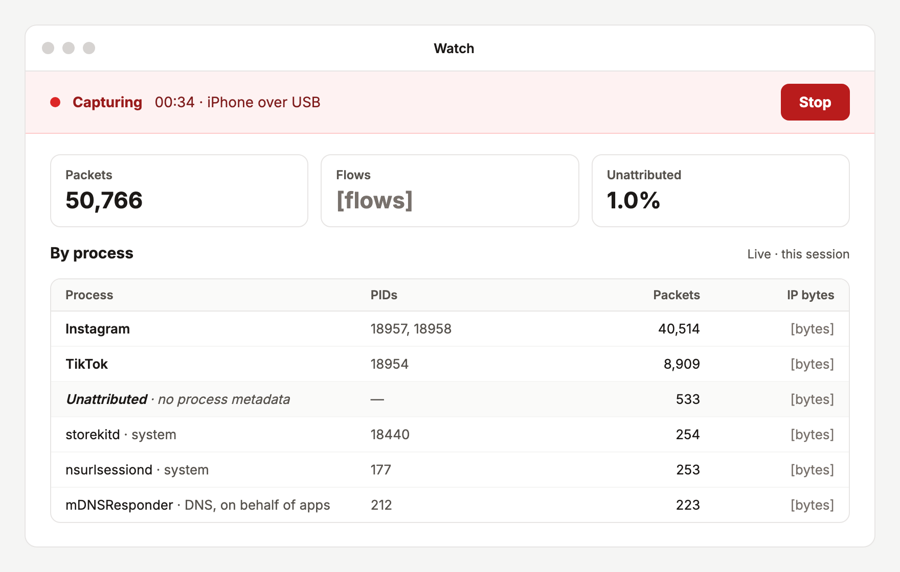

# Tattle

See which apps on an iPhone talk to which servers, when, and how much. No jailbreak needed, and nothing is decrypted.

Tattle is a macOS tool written in Swift. It captures an iPhone's network traffic over a USB cable, tags each packet with the app that sent it, groups packets into connections, and reads the hostname of each connection from the parts of the traffic that are not encrypted. Everything runs and stays on the Mac.

This is a personal research and portfolio project, not a product. It was inspired by the CBC Marketplace investigation *The App Trap* into what phone apps send in the background.

## What it shows

From a 3-minute capture of a phone running YouTube:

```
Top flows by IP bytes:
  app           ..:..  en0  udp  ...:443  in 2371918 out 23871  rr1---sn-....googlevideo.com [sni]  -> YouTube (1 pid)
  app           ..:..  en0  udp  ...:443  in  158329 out 115451  youtubei.googleapis.com [sni]     -> YouTube (1 pid)
  system        ..:..  en0  udp  ...:443  in   22026 out  11184  gateway.icloud.com [sni]          -> system nsurlsessiond
  app           ..:..  en0  udp  ...:443  in   10137 out   7528  ad.doubleclick.net [sni]          -> YouTube (1 pid)
```

Each hostname carries its source. `[sni]` means the name was read from that connection. `[dns, may be another service]` means it came from a DNS answer for the same server address, which on shared servers often names a different service than the connection asked for. A connection with no name shows the reason instead, for example `(Connection started before capture)`. The Mac app shows the same data live while a capture runs, with a Stop button, a per-app table and past sessions. Traffic is sorted into categories: the USB link to the Mac and local-network-only chatter are shown in their own "Not counted as phone traffic" section, outside the phone total, and never hidden.



*Design mockup made before the app was built, using numbers from a TikTok + Instagram test capture. More in [md/APP.md](md/APP.md).*

## How it works


```
iPhone ──USB──▶ rvi0 (rvictl) ──▶ tcpdump -U -P -w - ──stdout──▶ Tattle
                                                                   │
   PCAPNG reader ──▶ packet decoder ──▶ flow table ──▶ SQLite (7 days)
                           │                 ▲
                           ├──▶ DNS + SNI ───┘
                           └──▶ raw packet dropped
```

1. **Capture.** Apple's Remote Virtual Interface (`rvictl`) makes the phone's network stack visible on the Mac as `rvi0`. `tcpdump` streams it as PCAPNG.
2. **Attribution.** The capture uses Apple's PKTAP format, which tags each packet with the process name and PID that sent it. When a system service acts for an app, it also names that app (for example, a DNS lookup made by `mDNSResponder` for TikTok). Tattle reads these tags with its own PCAPNG parser, including Apple's undocumented process-information blocks.
3. **Decoding.** IPv4 and IPv6, TCP and UDP, on both Ethernet and tunnel interfaces. Byte counts use IP lengths, so the same traffic counts the same over Wi-Fi and cellular.
4. **Flows.** Packets are grouped into connections. Each connection keeps a tally of every process that touched it rather than a single label, so attribution can be recalculated later.
5. **Hostnames.** From DNS answers, from the TLS ClientHello's server name (SNI), and from QUIC Initial packets. QUIC Initials are encrypted with keys that anyone can derive from the packet itself (RFC 9001), so reading the hostname does not mean breaking any encryption.
6. **Storage.** SQLite through the system library. Records are written every few seconds while the capture runs.

## Restrictions

These are deliberate limits, or limits of the platform. They are not bugs.

| Restriction | Why |
|---|---|
| Needs a Mac and a USB cable | RVI only works over a wired connection to a Mac. An iPhone app on its own can't see other apps' traffic |
| Needs administrator rights on the Mac | `rvictl` and packet capture need root. The app asks for the admin password at each start |
| Can't be distributed through the Mac App Store | The App Sandbox blocks root and packet capture. A signed version would ship outside the store, like Wireshark |
| Never sees content | TLS and QUIC payloads stay encrypted. Tattle reads only hostnames and packet sizes |
| About 1% of packets have no process tag | Shown as "Unattributed". Tattle never guesses an app from an IP address |
| DNS can disappear | With iCloud Private Relay or encrypted DNS, DNS answers are invisible. Hostnames from SNI still work |
| Connections that started before the capture have no hostname | Their handshake happened before recording began. They are reported as "Connection started before capture", for TCP and for QUIC. A name is offered only as a hint when another connection of the same app to the same server has one |
| Process names are cut to 16 characters by iOS | For example, `appstorecomponen` |
| Untested with a VPN active | Traffic may be counted twice across the tunnel and the physical interface. Private Relay was tested and is not a tunnel |

## Security and privacy measures

- **No decryption, no content.** Only DNS answers, TLS/QUIC server names, packet headers and sizes are read. Tattle never parses plain-HTTP bodies, but a diagnostic file (below) contains them.
- **Raw packets stay off the disk unless the diagnostic switch is on.** tcpdump streams to Tattle through a pipe, and each packet is dropped once decoded. The only exception is a capped buffer (5 packets or 16 KB per connection) that holds packets until the hostname is found. Saving raw packets is a separate opt-in diagnostic switch that is off at every launch. When it is on, the whole stream, including any plain-HTTP bodies, is written to a file in a private `diagnostics` folder next to the database. The app deletes those files after 24 hours and with "Delete all"; the command-line tool does not delete its file.
- **Device identifier never stored.** The phone's UDID exists only in memory and in a short-lived 0600 script. The database stores a salted SHA-256 hash, and logs and error messages never contain the UDID.
- **Local only.** Tattle makes no network requests. The database is created with 0600 permissions in a 0700 directory.
- **Limited retention.** Sessions expire after 7 days, and "Delete all" removes every stored session and every diagnostic file made by the app.
- **Root access kept narrow.** The app itself never runs as root. At Start it runs a generated script through the macOS admin dialog. The script does three things only: start RVI, run tcpdump on that one interface, and stop both. It tears RVI down on every exit path, and its log is kept for debugging.
- **Nothing is guessed.** "Unknown app" and "unknown hostname" are separate states. A DNS answer is shown as evidence, not as proof that the app connected.

## What Tattle stores

| What | Where | Kept | Removed by "Delete all" |
|---|---|---|---|
| Sessions, flows, per-app tallies, DNS answers, server names, per-session gap and save counts (numbers only) | `watch.sqlite` and its `-wal` and `-shm` files (0600, in a 0700 folder) | 7 days after a session ends | Yes, and the file is vacuumed so no deleted names remain |
| Salted device hash, device name | Same database | Same as sessions | Sessions yes; the install salt is kept so that device hashes stay stable |
| Raw-packet diagnostic files (opt-in) | App: `diagnostics` folder next to the database. Command line: the file you name with `--diagnostic` | App: 24 hours. Command line: user-managed | App files yes; command-line files no |
| Retention setting (a number of days) | The app's preferences (UserDefaults) | Until changed | No |
| Short-lived temporary files: device list from `devicectl` (holds the device name and id), output of `rvictl` and `ifconfig` | The per-user temporary folder (0700; the tool-output file is also 0600) | Deleted when the command finishes; a crash can leave one until the system clears the temporary folder | No |
| Band files (`report --write-bands`): counts and ratios per test capture, numbers only | The file you name | User-managed | No |
| Capture script log and run folder | The root script's run folder | Removed by `stop()`; a directory a crashed app left is stopped and removed at the next launch. The script log moves to `logs/` (newest 10 kept) | No; no packets or hostnames in it |
| Quality report JSON | Printed by `tattle report`; where the user saves it | User-managed | No |
| Metrics file (opt-in `--metrics` on the command line): packet and flow counts, cap counters, gap counts, memory size; numbers only | The file you name, created new with mode 0600 | User-managed | No |
| Fixture captures (developers only) | `~/dev/tattle-fixtures` | User-managed | No |

Full list: [md/STORAGE.md](md/STORAGE.md#data-inventory).

## Results so far

| Check | Result |
|---|---|
| Our PCAPNG reader vs tcpdump | Same packet and per-process counts on all test captures |
| Throughput (full pipeline, release build) | About 610,000 to 635,000 packets/s (Milestone 1: about 620,000 to 660,000 on the same machine, within 10%). A busy phone produces about 1,500 packets/s |
| Live captures on a phone | Streams, attributes and stops cleanly. In one 3-minute run: 26,916 packets, 0 malformed |
| 30-minute capture of normal use (browsing, video, phone locked) | 551,475 packets, 1,286 connections, 0 packets dropped. Memory stayed between 8.5 and 13.3 MB and was flat over the last 20 minutes (about 0.03 MB per hour). Stopped cleanly at 30 minutes |
| Tests | 389 (Swift Testing). They use hand-built captures, fake `rvictl`/`tcpdump` scripts and real fixture captures kept outside the repo |

### Milestone 2 results

Measured 2026-11-18 on five scripted captures, a 30-minute run and a real cable pull. Numbers only.

| Measure | Milestone 1 | Milestone 2 | How |
|---|---|---|---|
| Every byte in a category, counts reconcile | not checked | all checks pass on 6 captures and the synthetic corpus | `report` exit code |
| Bytes with no process tag | 0.02% to 1.2% | unchanged (0.02% to 1.2%); never above the baseline by 0.5 points | band check |
| Idle phone: share of bytes that is USB link, local network or iOS system | no categories | 73.5% (the goal of 95% was not met: the idle capture was not quiet) | idle capture |
| Expected apps wrongly counted as USB link | not checked | 0 of 4 captures | scenario score |
| HTTPS bytes with a hostname read from the handshake | 99.1% to 100% | 99.7% to 100% on fresh-start captures; 1.1% on a capture started during playback (reason shown for all the rest) | report |
| DNS names that match the connection's own name | not measured | 94% (idle), 7% (two apps), 99.9% (video): shown as hints only | `dnsPrecision` |
| Memory over 30 minutes | not measured | 8.5 to 13.3 MB, flat (0.03 MB per hour), 241 open connections at most, 0 packets dropped | `--metrics` |
| Cable pulled | session left open | noticed in 2 to 3 s, session saved as interrupted, 164 of 164 connections kept | real phone |
| Throughput | 620,000 packets/s | 610,000 to 634,000 packets/s (3.5% to 6.2% below the Milestone 1 build) | `bench` |

Not done in Milestone 2: VPN double-counting rule (needs a VPN capture), TCP retransmission counting, naming connections from earlier sessions' DNS, a 2-hour soak, automatic reconnect.

### Baseline for Milestone 2

Measured on 2026-11-18 on four scripted captures (idle phone, one browser, two social apps one after the other, a video app), with the Milestone 1 behaviour. Later changes are checked against these numbers in the tests: none may fall more than 0.5 points below its baseline.

| Measure | Idle | Browser | Two apps | Video |
|---|---|---|---|---|
| Bytes attributed to a process | 99.6% | 98.8% | 99.9% | 99.98% |
| Bytes with no process tag | 0.4% | 1.2% | 0.05% | 0.02% |
| HTTPS bytes with a hostname from the handshake | 99.9% | 99.1% | 99.99% | 99.997% |
| Expected app on top in its time window | no expectation | 1 / 1 | 2 / 2 | 1 / 1 |
| Expected sites found | none expected | 2 / 2 | none expected | none expected |

Share of bytes by category on the same captures (Milestone 2, after validation on real data):

| Category | Idle | Browser | Two apps | Video |
|---|---|---|---|---|
| From app | 23.9% | 0.6% | 99.4% | 99.5% |
| Helper for an app | 2.5% | 80.6% | 0.2% | 0.1% |
| iOS system | 72.5% | 16.8% | 0.3% | 0.3% |
| USB link to this Mac | 0.3% | 0.7% | 0.0% | 0.0% |
| Local network only | 0.7% | 1.3% | 0.0% | 0.1% |
| No process info | 0.1% | 0.1% | 0.0% | 0.0% |
| Expected apps wrongly counted as USB link | 0 | 0 | 0 | 0 |

In the browser capture most bytes are "Helper for an app" because Safari does its networking through a separate WebKit process that works on Safari's behalf; it still counts as the browser's traffic. The idle capture was not quiet: link + local + system is 73.5% of its bytes, not the 95% first guessed. One app opened about 185 connections after a notification arrived (26% of bytes). The rules never move app-tagged traffic, so the idle check is set to 71.4% (measured minus 2 points).

These captures start every app fresh, so nearly every connection's handshake is seen. In a long real session it is different: on one earlier session only 5.4% of HTTPS bytes had a hostname, because the largest connections were already open when capture began. A capture started while a video was already playing shows it: 98.9% of app HTTPS bytes were in QUIC connections that began before recording, and only 1.1% had a hostname. Those bytes are counted as "connection started before capture" and cannot be named from the traffic. DNS names and same-server names are shown only as labelled hints, because on shared servers they often name another service (DNS agreed with the connection's own name on 7% of bytes in the two-app capture and 99.9% in the video capture).

## Running it

Requirements: macOS 13+, Xcode command-line tools (Swift 6), and an iPhone that is unlocked and has trusted the Mac.

```sh
swift build -c release

# command line
.build/release/tattle flows capture.pcapng                    # analyse a saved capture
sudo .build/release/tattle capture --device iphone --db ~/watch.sqlite   # live capture, Ctrl-C to stop

tattle report capture.pcapng [--detail] [--json]              # quality report; exit 2 if a check fails
tattle report --db ~/watch.sqlite --session latest          # report on a stored session

# Mac app (prototype)
swift run TattleApp

# tests (fixture tests run when TATTLE_FIXTURES points at a folder of captures; WATCH_FIXTURES is the deprecated old name)
scripts/test.sh
```

## Layout

| Target | Does |
|---|---|
| `PCAPNG` | Streaming PCAPNG parser with Apple process blocks |
| `PacketDecoder` | Link, IP and TCP/UDP headers, byte counts, direction |
| `Flows` | Connection table with per-process tallies |
| `Domains` | DNS, TLS SNI, QUIC Initial decryption |
| `Attribution` | Process evidence to app, system or unknown |
| `Storage` | SQLite schema, retention, salted device hash |
| `Pipeline` | Ties the steps together, for live capture and file replay |
| `Capture` | rvictl/tcpdump control, privileged launcher, device lookup |
| `tattle` (target `TattleCLI`), `TattleApp` | Command-line tool and SwiftUI app |

Originally called Watch; renamed to Tattle on 2026-11-21 because "Watch" could conflict with Apple Watch for an iOS app. The old `~/Library/Application Support/Watch` folder is moved to `Tattle` on first run.

Design notes for each part are in [md/](md/). Start with [OVERVIEW.md](md/OVERVIEW.md) and [DESIGN.md](md/DESIGN.md).

## Status

Milestone 2 is done: capture and analysis on the Mac work end to end, every byte is put in a stated category, hostnames carry their source, and a quality report with committed bands catches regressions. Next (Milestone 3): company and tracker classification, a destination map, an App Privacy Report import (the phone's own 7-day log, shown next to Mac captures), and a signed helper. See the roadmap in [OVERVIEW.md](md/OVERVIEW.md#current-status).
