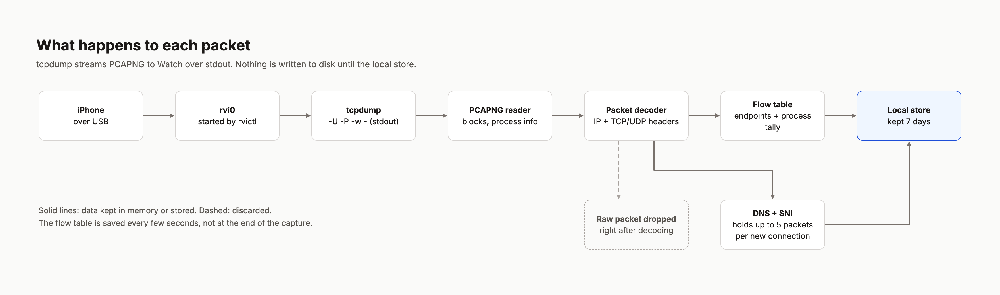

# Watch

See which apps on an iPhone talk to which servers, when, and how much. No jailbreak needed, and nothing is decrypted.

Watch is a macOS tool written in Swift. It captures an iPhone's network traffic over a USB cable, tags each packet with the app that sent it, groups packets into connections, and reads the hostname of each connection from the parts of the traffic that are not encrypted. Everything runs and stays on the Mac.

This is a personal research and portfolio project, not a product. It was inspired by the CBC Marketplace investigation *The App Trap* into what phone apps send in the background.

## What it shows

From a 3-minute capture of a phone running YouTube:

```
Top flows by IP bytes:
  en0  udp  ...:443  in 2371918 out 23871  rr1---sn-....googlevideo.com  -> YouTube (1 pid)
  en0  udp  ...:443  in  158329 out 115451  youtubei.googleapis.com     -> YouTube (1 pid)
  en0  udp  ...:443  in   22026 out  11184  gateway.icloud.com          -> system nsurlsessiond
  en0  udp  ...:443  in   10137 out   7528  ad.doubleclick.net          -> YouTube (1 pid)
```

The Mac app shows the same data live while a capture runs, with a Stop button, a per-app table and past sessions. Traffic is sorted into categories: the USB link to the Mac and local-network-only chatter are shown in their own "Not counted as phone traffic" section, outside the phone total, and never hidden.


*Design mockup made before the app was built, using numbers from a TikTok + Instagram test capture. More in [md/APP.md](md/APP.md).*

## How it works



```
iPhone ──USB──▶ rvi0 (rvictl) ──▶ tcpdump -U -P -w - ──stdout──▶ Watch
                                                                   │
   PCAPNG reader ──▶ packet decoder ──▶ flow table ──▶ SQLite (7 days)
                           │                 ▲
                           ├──▶ DNS + SNI ───┘
                           └──▶ raw packet dropped
```

1. **Capture.** Apple's Remote Virtual Interface (`rvictl`) makes the phone's network stack visible on the Mac as `rvi0`. `tcpdump` streams it as PCAPNG.
2. **Attribution.** The capture uses Apple's PKTAP format, which tags each packet with the process name and PID that sent it. When a system service acts for an app, it also names that app (for example, a DNS lookup made by `mDNSResponder` for TikTok). Watch reads these tags with its own PCAPNG parser, including Apple's undocumented process-information blocks.
3. **Decoding.** IPv4 and IPv6, TCP and UDP, on both Ethernet and tunnel interfaces. Byte counts use IP lengths, so the same traffic counts the same over Wi-Fi and cellular.
4. **Flows.** Packets are grouped into connections. Each connection keeps a tally of every process that touched it rather than a single label, so attribution can be recalculated later.
5. **Hostnames.** From DNS answers, from the TLS ClientHello's server name (SNI), and from QUIC Initial packets. QUIC Initials are encrypted with keys that anyone can derive from the packet itself (RFC 9001), so reading the hostname does not mean breaking any encryption.
6. **Storage.** SQLite through the system library. Records are written every few seconds while the capture runs.

## Restrictions

These are deliberate limits, or limits of the platform. They are not bugs.

| Restriction | Why |
|---|---|
| Needs a Mac and a USB cable | RVI only works over a wired connection to a Mac. An iPhone app on its own can't see other apps' traffic |
| Needs administrator rights on the Mac | `rvictl` and packet capture need root. The app asks for the admin password at each start |
| Can't be distributed through the Mac App Store | The App Sandbox blocks root and packet capture. A signed version would ship outside the store, like Wireshark |
| Never sees content | TLS and QUIC payloads stay encrypted. Watch reads only hostnames and packet sizes |
| About 1% of packets have no process tag | Shown as "Unattributed". Watch never guesses an app from an IP address |
| DNS can disappear | With iCloud Private Relay or encrypted DNS, DNS answers are invisible. Hostnames from SNI still work |
| Connections that started before the capture have no hostname | Their handshake happened before recording began |
| Process names are cut to 16 characters by iOS | For example, `appstorecomponen` |
| Untested with a VPN active | Traffic may be counted twice across the tunnel and the physical interface. Private Relay was tested and is not a tunnel |

## Security and privacy measures

- **No decryption, no content.** Only DNS answers, TLS/QUIC server names, packet headers and sizes are read. Watch never parses plain-HTTP bodies, but a diagnostic file (below) contains them.
- **Raw packets stay off the disk unless the diagnostic switch is on.** tcpdump streams to Watch through a pipe, and each packet is dropped once decoded. The only exception is a capped buffer (5 packets or 16 KB per connection) that holds packets until the hostname is found. Saving raw packets is a separate opt-in diagnostic switch that is off at every launch. When it is on, the whole stream, including any plain-HTTP bodies, is written to a file in a private `diagnostics` folder next to the database. The app deletes those files after 24 hours and with "Delete all"; the command-line tool does not delete its file.
- **Device identifier never stored.** The phone's UDID exists only in memory and in a short-lived 0600 script. The database stores a salted SHA-256 hash, and logs and error messages never contain the UDID.
- **Local only.** Watch makes no network requests. The database is created with 0600 permissions in a 0700 directory.
- **Limited retention.** Sessions expire after 7 days, and "Delete all" removes every stored session and every diagnostic file made by the app.
- **Root access kept narrow.** The app itself never runs as root. At Start it runs a generated script through the macOS admin dialog. The script does three things only: start RVI, run tcpdump on that one interface, and stop both. It tears RVI down on every exit path, and its log is kept for debugging.
- **Nothing is guessed.** "Unknown app" and "unknown hostname" are separate states. A DNS answer is shown as evidence, not as proof that the app connected.

## What Watch stores

| What | Where | Kept | Removed by "Delete all" |
|---|---|---|---|
| Sessions, flows, per-app tallies, DNS answers, server names | `watch.sqlite` (0600, in a 0700 folder) | 7 days after a session ends | Yes, and the file is vacuumed so no deleted names remain |
| Salted device hash, device name | Same database | Same as sessions | Sessions yes; the install salt is kept so that device hashes stay stable |
| Raw-packet diagnostic files (opt-in) | `diagnostics` folder next to the database | 24 hours | Yes |
| Capture script log and run folder | The root script's run folder | Until the next run or reboot | No; no packets or hostnames in it |
| Quality report JSON | Printed by `WatchCapture report`; where the user saves it | User-managed | No |
| Fixture captures (developers only) | `~/dev/watch-fixtures` | User-managed | No |

Full list: [md/STORAGE.md](md/STORAGE.md#data-inventory).

## Results so far

| Check | Result |
|---|---|
| Our PCAPNG reader vs tcpdump | Same packet and per-process counts on all test captures |
| Throughput (full pipeline, release build) | About 620,000 packets/s. A busy phone produces about 1,500 packets/s |
| Live captures on a phone | Streams, attributes and stops cleanly. In one 3-minute run: 26,916 packets, 0 malformed |
| Tests | 286 (Swift Testing). They use hand-built captures, fake `rvictl`/`tcpdump` scripts and real fixture captures kept outside the repo |

### Baseline for Milestone 2

Measured on 2026-11-18 on four scripted captures (idle phone, one browser, two social apps one after the other, a video app), with the Milestone 1 behaviour. Later changes are checked against these numbers in the tests: none may fall more than 0.5 points below its baseline.

| Measure | Idle | Browser | Two apps | Video |
|---|---|---|---|---|
| Bytes attributed to a process | 99.6% | 98.8% | 99.9% | 99.98% |
| Bytes with no process tag | 0.4% | 1.2% | 0.05% | 0.02% |
| HTTPS bytes with a hostname from the handshake | 99.9% | 99.1% | 99.99% | 99.997% |
| Expected app on top in its time window | no expectation | 1 / 1 | 2 / 2 | 1 / 1 |
| Expected sites found | none expected | 2 / 2 | none expected | none expected |

These captures start every app fresh, so nearly every connection's handshake is seen. In a long real session it is different: on one earlier session only 5.4% of HTTPS bytes had a hostname, because the largest connections were already open when capture began. Closing that gap is part of Milestone 2.

## Running it

Requirements: macOS 13+, Xcode command-line tools (Swift 6), and an iPhone that is unlocked and has trusted the Mac.

```sh
swift build -c release

# command line
.build/release/WatchCapture flows capture.pcapng                    # analyse a saved capture
sudo .build/release/WatchCapture capture --device iphone --db ~/watch.sqlite   # live capture, Ctrl-C to stop

WatchCapture report capture.pcapng [--detail] [--json]              # quality report; exit 2 if a check fails
WatchCapture report --db ~/watch.sqlite --session latest          # report on a stored session

# Mac app (prototype)
swift run WatchApp

# tests (fixture tests run when WATCH_FIXTURES points at a folder of captures)
scripts/test.sh
```

## Layout

| Target | Does |
|---|---|
| `PCAPNG` | Streaming PCAPNG parser with Apple process blocks |
| `PacketDecoder` | Link, IP and TCP/UDP headers, byte counts, direction |
| `Flows` | Connection table with per-process tallies |
| `Domains` | DNS, TLS SNI, QUIC Initial decryption |
| `Attribution` | Process evidence to app, system or unknown |
| `Storage` | SQLite schema, retention, salted device hash |
| `Pipeline` | Ties the steps together, for live capture and file replay |
| `Capture` | rvictl/tcpdump control, privileged launcher, device lookup |
| `WatchCapture`, `WatchApp` | Command-line tool and SwiftUI app |

Design notes for each part are in [md/](md/). Start with [OVERVIEW.md](md/OVERVIEW.md) and [DESIGN.md](md/DESIGN.md).

## Status

Capture and analysis on the Mac work end to end. The USB link's own traffic is now kept out of the phone total and shown separately. Next: fill in hostnames for connections that started before the capture, run a long-session stability test, and later add company/tracker classification and a destination map. See the roadmap in [OVERVIEW.md](md/OVERVIEW.md#current-status).
