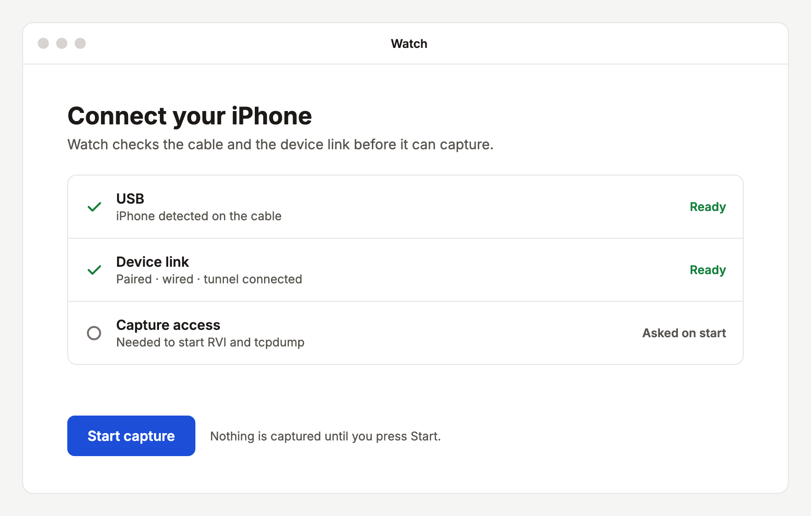
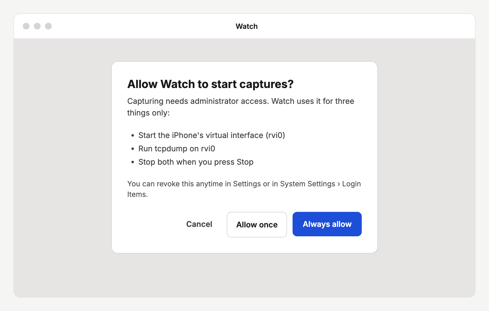
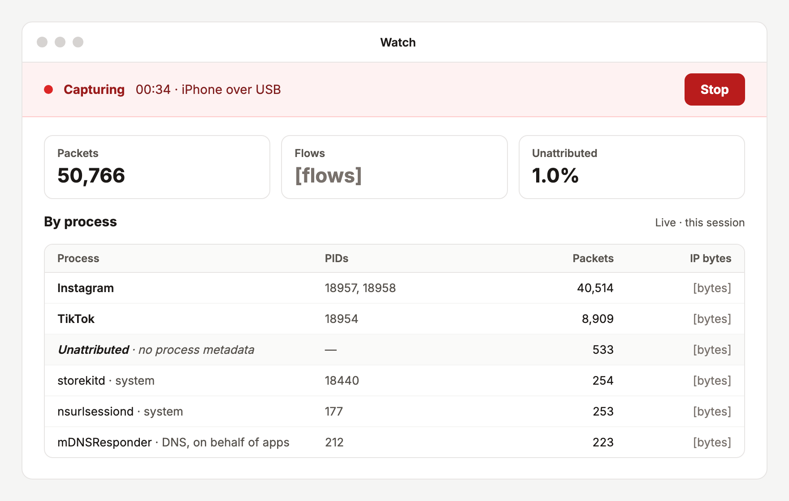
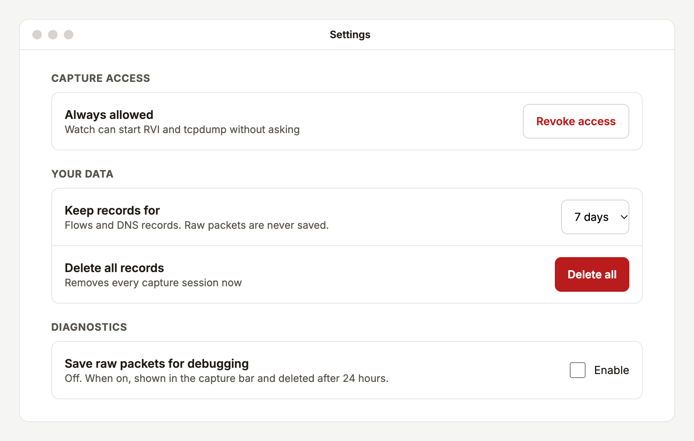

# App

**Status:** Working prototype (2026-11-17). Connect → admin password → Live → Stop → Sessions all verified on the phone (35,577 packets / 446 flows in one run). Stop ends tcpdump with KILL after ~2 s by design (see [CAPTURE.md](CAPTURE.md)). Known cosmetic bug: system rows other than mDNSResponder say "lookups for" instead of "on behalf of".

Mockups (made before the app was built):

| Connect | Grant access |
|---|---|
|  |  |
| **Live capture** | **Settings** |
|  |  |

## Purpose

- The Mac app the user drives: connect, start, watch live, stop, review, delete
- Assumes the Mac shows the data in V1 (open question in [DESIGN.md](DESIGN.md#10-open-questions))

## Screens

| Screen | Shows | Requirements |
|---|---|---|
| Connect | USB, device link and capture access checks, Start button | F1 |
| Grant access | Allow once / Always allow / Cancel, what root is used for | N6 |
| Live capture | Red capture bar with timer and Stop, totals, traffic by process | F2, F3, F4 |
| Settings | Revoke access, retention, delete all, diagnostic capture | N2, N6 |

## Live capture

- Capture bar always visible while capturing, with a large Stop (F3)
- Totals: packets, flows, phone traffic (bytes), share unattributed
    - "Phone traffic" is the IP bytes of flows in the categories `app`, `helper`, `system` and `unknown` (see [REPORT.md](REPORT.md)); it excludes the two set-aside categories below
- Phone traffic by process: name, PIDs, packets, IP bytes
    - Unattributed is its own row, never hidden or merged
    - System processes labelled as system
    - `mDNSResponder` rows say which apps the lookups were for
    - Names are display names (`ProcessNames.displayName`); when the kernel's raw name differs, the row shows "process name: ..." under the title
- "Not counted as phone traffic" section under the table, two lines that are always present, each with its bytes
    - `USB link to this Mac` (`deviceLink`) and `Local network only` (`localNetwork`); the text comes from `TrafficCategory.label`
    - Click a line to expand it to the process rows inside; nothing is hidden, only kept out of the phone total
- Session detail has the same two sections; each flow is classified once and its tally rows carry the flow's category
- In the top-flows tables a flow that is not phone traffic shows its category label under the app name
- Labelled "Live · this session" so it can't be mistaken for history
- Bounded memory (6.1): the live list is built from the pipeline's retained flows, at most 50,000. When older closed flows were dropped (`retainedDropped > 0`) the screen says "Older flows are in the saved session. The totals below cover the newest flows only." The saved session in the database is complete
- The top-flows table shows 10 rows. Flows left out fold into one grey line "N more flows" (`FlowRows.foldLine`); the same helper, `flowRows(_:limit:)`, defaults to 500 rows for a longer list
- The cap table is in [PIPELINE.md](PIPELINE.md)

## Rules for what the UI says

- Show counts as packets or bytes, never as "data sent to company X"
- DNS-only hostnames are labelled "from DNS", not "contacted"
- Unknown is written as unknown, never left blank or guessed

## Later

- Session history list and per-session detail
- Per-flow view with server name and domain evidence
- Filter by app (default: All Apps)

## Implementation spec (prototype, free mode)

Target `WatchApp` (SwiftUI, SwiftPM executable, no app bundle yet; run with `swift run WatchApp` as the normal user). Depends on `Capture`, `Pipeline`, `Storage`, `Attribution`, `Flows`, `Domains`, `PacketDecoder`, `PCAPNG`. Tests in `WatchAppTests` for the non-UI logic.

### Getting root without running the GUI as root

- The app never runs as root. On Start it launches a privileged script through `osascript -e 'do shell script "/bin/sh <scriptPath>" with administrator privileges'`, which shows the native admin-password dialog (the "Grant access" screen's **Allow once**). This is a stand-in for the `SMAppService` helper; the protocol is the same three steps
- `PrototypeCaptureLauncher` (in the `Capture` target):
    - makes a private run directory (`0700`, under `~/Library/Application Support/Watch/run/<uuid>/`) holding `script.sh` (`0600`), a FIFO `stream`, and the path of a `stop` marker
    - `script.sh`: run `rvictl -s <udid>`; require `[SUCCEEDED]` and parse `with interface <rviN>`; `exec tcpdump -i <rviN> -n -p -s 0 -U -P -w - > stream &`; loop `while [ ! -e stop ] && kill -0 $pid; do sleep 0.2; done`; `kill -INT $pid; wait $pid`; `rvictl -x <udid>`; exit codes 1 rvi failed, 2 tcpdump failed. Its stderr goes to `log` in the run dir
    - `start(udid:) async throws -> FileHandlePacketSource`: writes the script, runs osascript on a background task, opens the FIFO for reading (opening blocks until tcpdump opens the write end; do it on a background task with a 60 s timeout for the password dialog) and returns the source
    - `stop() async`: creates the `stop` file, waits for osascript to exit (up to 5 s), deletes the run directory including the script (the udid lives only there, briefly, and in memory)
    - osascript cancelled by the user → `CaptureError.accessDenied`; nothing started
- `FileHandlePacketSource` (in `PCAPNG`): a `PacketSource` over a `FileHandle`, 64 KB reads through `PCAPNGStreamParser`; `ProcessPacketSource` can be rebuilt on top of it, but leave it as is
- `DeviceLookup` (in `Capture`): move the devicectl lookup out of the CLI into `public struct DeviceLookup { static func wiredDevices() async throws -> [DeviceSummary] }` with `DeviceSummary { name, udid, transport, pairing, tunnel }`; the CLI's `capture --device` and the app both use it. `DeviceSummary` is never printed whole; views show `name` only

### App structure

- `@main struct WatchApp: App` with `NSApplicationDelegateAdaptor` that sets `NSApp.setActivationPolicy(.regular)` and activates the app (needed when launched from `swift run`)
- `@MainActor final class AppModel: ObservableObject` owns everything the views show:
    - `deviceStatus: DeviceStatus?` refreshed every 5 s while on the Connect screen (devicectl is slow; never block the main thread)
    - `captureState: idle | requestingAccess | starting | capturing(since: Date) | stopping | failed(message)`
    - `liveStats: PipelineStats`, `liveFlows: [Flow]`, `liveDNS: [DomainObservation]`, refreshed every 2 s from the pipeline (`stats`, `flowsSnapshot()` with `retainFlows: true`, `dnsSnapshot()`)
    - `grouping: ProcessGrouping` computed from `liveFlows`: `rows` (phone traffic) group by `Attributor.attribute(flow.tally)` → display name (or "Unattributed", "System: name"), with pid set, packets, IP bytes; sorted by bytes. `setAside` has one row per non-phone category, each with its process rows in `children`. `TallyInput.category` comes from `Classifier.classify` on the flow
    - `sessions: [SessionRow]` from `Store.sessions()` plus per-session packet/flow counts
    - settings: `retentionDays` (7 default, `@AppStorage`), `diagnosticCapture` (off)
    - `startCapture()`: device check → `requestingAccess` → launcher.start → new `Store(path:)` for the pipeline (the app keeps its own `Store` for reads; SQLite WAL allows both) → `CapturePipeline(... retainFlows: true)` → `run` on a task → `capturing`. Any failure → `failed(message)` with the launcher stopped
    - `stopCapture()`: `stopping` → `launcher.stop()` → wait for `run` to return → `pipeline.stop(reason: .captureStopped)` → `idle`, sessions refreshed
    - on launch: `store.markInterruptedSessions()`, `store.expire(olderThan: retentionDays × 86400)`, `DiagnosticFiles.purge` (24 hours)
    - `deleteAll()`: `DiagnosticFiles.purgeAll`, then `store.deleteAll()`
- Views, one file each, matching the mockup (see the mockups above):
    - `ConnectView`: three check rows (USB, Device link, Capture access = "Asked on start"), Start button enabled only when ready
    - `AccessView`: the explanation and three buttons; **Allow once** triggers the osascript prompt; **Always allow** disabled with the note "needs the signed helper (later)"; Cancel
    - `LiveView`: red capture bar (dot, "Capturing", mm:ss timer, interface, Stop), four tiles (packets, flows, phone traffic bytes, % unattributed), the phone traffic by-process table (Unattributed row always present, system rows labelled), the "Not counted as phone traffic" section, top 10 flows by bytes with hostname, its source or the reason it has none, and attribution
    - `SessionsView`: list of past sessions (start, duration, packets, flows), select one to see the same phone traffic table and set-aside section (built from `store.flows`, bytes shared out by packet count per tally row) and top flows
    - `SettingsView`: capture access (shows "Asked each time (prototype)"; Revoke disabled), retention picker 1/3/7 days, Delete all (with confirmation), diagnostic capture toggle (writes the raw stream to `~/Library/Application Support/Watch/diagnostics/diagnostic-<date>.pcapng` via a tee; shown in the capture bar when on; files are deleted after 24 hours at app start and by Delete all, see [CAPTURE.md](CAPTURE.md#diagnostic-capture))
    - Window: sidebar (Connect, Live, Sessions, Settings) + detail, 880×560 minimum. Live is selected automatically when a capture starts
- The UI never shows the udid or the device hash. Addresses and hostnames are shown (that is the product), nothing else leaves the process

### Hostname labels in the flow tables

- `topFlows(flows, observations:)` builds one `HostnameIndex` per refresh (live: `dnsSnapshot()`; sessions: `store.domains(session:)`), then calls `outcome(for:)` for each shown flow. Reason logic is shared with the report and the CLI; the screens only map it to text
- A name from DNS is a guess about shared server addresses (on real captures, 0.07 to 0.999 of DNS names equalled the connection's own name). It is shown in italic secondary style with a caveat, never like an observed name. The tooltip gives the full sentence and the DNS answer's age

| Case | Name cell | Second line | Tooltip |
|---|---|---|---|
| `sni` | name, normal style | Seen in connection | Seen in connection |
| `dns` | name, secondary italic | From DNS, may differ | From DNS (may be another service on the same server). The DNS answer came N.N s before the connection |
| `sameAddress` | name, secondary italic | Same server as another connection, may differ | Same server as another connection of this app (may be another service) |
| `startedBeforeCapture` | none | Connection started before capture | same |
| `echHidden` | none | Name hidden by the app (ECH) | same |
| `noHandshakeUDP`, `noDNSMatch` | none | No name found | same |

- The text lives in `HostnameSource.label`, `.shortLabel` and `UnnamedReason.label` (`Attribution/Hostnames.swift`)

### Tests (`WatchAppTests`, no UI)

- `groupByProcess` from hand-built flows: an app with two pids collapses to one row; `.none`-only tally → "Unattributed" row; system process → "System:" row; sorted by bytes; `deviceLink` and `localNetwork` flows go to `setAside` and stay out of the phone total; set-aside labels equal `TrafficCategory.label`; display names replace raw names
- `topFlows`: `sni` flow says "Seen in connection", a `dns` flow carries the may-differ caveat and its age, unnamed flows show their reason; the index is built once for 100 flows
- `PrototypeCaptureLauncher.renderScript(udid:, runDirectory:)` contains the rvictl, tcpdump `-P -w -` and `rvictl -x` lines, the stop loop, and exits non-zero without `[SUCCEEDED]`
- Run directory and script are created `0700`/`0600` and removed by `stop()` even if `start` failed
- `DeviceLookup` decodes a saved devicectl JSON sample (wired and absent cases)

### Acceptance

- `swift build` and `swift test` green; `swift run WatchApp` opens the window as the normal user
- Live run on the phone (user): Start → password dialog → Live screen fills → Stop → session appears in Sessions; `rvictl -l` empty afterwards

## Open questions

- SwiftUI app target alongside the SwiftPM package, or move to an Xcode project when the helper needs signing?
- Menu bar item showing capture state?

## See also

[CAPTURE.md](CAPTURE.md) · [ATTRIBUTION.md](ATTRIBUTION.md) · [STORAGE.md](STORAGE.md)
